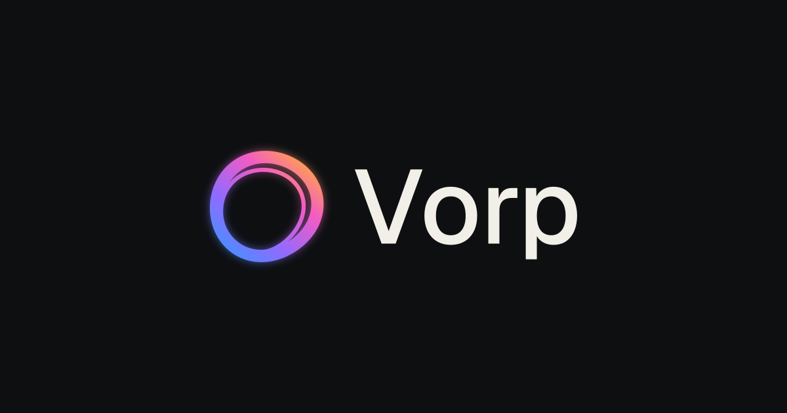
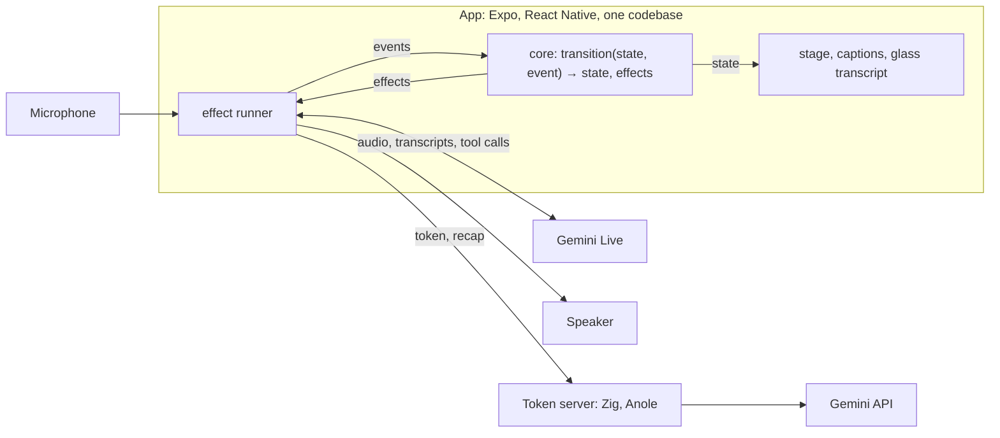

<p align="center">
  
</p>

<p align="center">
  A live voice interpreter. Two or three people speak normally, each in their own language.<br>
  When someone stops, Vorp speaks it in the other language — and keeps listening while it talks.
</p>

<p align="center">
  Built for the GDG Sudbury hackathon, 2026 (theme: language and culture).
</p>

<p align="center">
  
  &nbsp;&nbsp;
  
</p>

## What it does

- **Hands-free.** Voice activity detection ends each turn, and the language spoken identifies the
  speaker and direction. A hold-to-talk button per person stays available for noisy rooms or
  participants who share a language.
- **Listens while it speaks.** New speech is captured while a translation plays and spoken next,
  in order. Platform echo cancellation and a transcript echo guard keep Vorp's own voice out of
  the conversation, history, and recap.
- **Two or three people.** With three languages, translations are spoken sequentially into every
  other participant's language, with speaker labels in the transcript.
- **An interpreter, not a chatbot.** Carries meaning, tone, and register across (neutral, casual,
  formal) and never answers on its own behalf.
- **Cultural notes.** Idioms and references get a short written note in the listener's language
  under the caption — never spoken.
- **Tinted glass transcript and recap.** Each turn appears as a frosted glass bubble tinted in
  its speaker's hue, positioned by seat, followed by a bilingual summary when the conversation
  ends.
- **Private by design.** Every language the model supports, selectable interpreter voices, light
  and dark themes, and text-only history kept on the device (newest 50). Audio is never stored.
- **Offline demo.** Press **Demo** to watch a recorded conversation with live audio, ring,
  avatar, distortion wave, glow, cultural note, and recap — no microphone, network, or key
  needed.

## How Gemini is used

| Capability | Model / API | Role in Vorp |
| --- | --- | --- |
| Live speech pipeline | `gemini-3.8-live` (Live API) | Single streaming session for microphone audio in, translated speech out, live transcripts, and server-side VAD (`NO_INTERRUPTION`) |
| In-session tools | Function calling | `report_language` identifies who spoke; `add_note` attaches caption-only cultural notes in the listener's language |
| Ephemeral tokens | `/v1beta/auth_tokens` | The Anole server mints single-use Live tokens (`POST /token`) so the API key never reaches the browser |
| Conversation recap | `gemini-3.8-flash` | Writes a summary in every participant's language on the server (`POST /recap`) |
| Demo voices | `gemini-3.8-flash-tts` | Spoke the recorded lines bundled for the offline demo |

## Run it

Needs [Bun](https://bun.sh), [Zig 0.17](https://ziglang.org), and a Gemini API key.

```bash
bun install
cp .env.example .env          # put your key in GEMINI_API_KEY

bun run token-server          # terminal 1: tokens and recaps on :8787
EXPO_PUBLIC_TOKEN_URL=http://localhost:8787/token bunx expo start --web --port 8081   # terminal 2
```

Open `http://localhost:8081`. Press **Demo** to watch a recorded conversation, or **Start** and
talk.

To serve everything from one origin, as in production:

```bash
bun run export:web
WEB_DIR=dist bun run token-server     # the app is at http://localhost:8787
```

`/token` and `/recap` share a per-client rate limit (`TOKEN_RATE_LIMIT`, default 20/min). Behind
a TLS proxy or load balancer, set `ANOLE_PROXY_TRUSTED` so limits key on each visitor's address
(see `.env.example`).

Checks: `bun run lint`, `bun run typecheck`, `bun test`, `bun run test:server`.
`bun run e2e:live` speaks recorded sentences through the web build against the real API.

## How it is built



- **One state machine.** An utterance moves through
  `capturing → translating → queued → speaking → done | failed`. The whole conversation is one
  value and one pure function; effects are data run by a single runner. Listening while speaking
  is not a special mode — it is two utterances at different stages. Stopping or failing archives
  whatever was heard and releases audio cleanly.
- **Services behind interfaces.** Microphone, speaker, translator, recap, and storage each have
  one interface. The demo runs the same stage on scripted implementations of them.
- **Swappable visuals.** The voice ring, talking avatar, thinking orbs, golden caption glow, and
  distortion wave are slots with typed contracts and a registry that Settings can swap at
  runtime, paired with frosted tinted glass transcript bubbles (`Glass`).
- **Tables, not branches.** Languages, voices, tones, behaviours, and overlap policies are data.

See [`AGENTS.md`](AGENTS.md) for design decisions, [`TODO.md`](TODO.md) for the roadmap, and
[`assets/brand/README.md`](assets/brand/README.md) for brand assets and usage.

## Status

Web is the demo target and works in Chrome. Android and iOS build from the same codebase, but
the native audio services are not written yet.

## Credits and licence

Apache-2.0. Visual effect engines are from
[Libraries.dev](https://github.com/Jakubantalik/Libraries.dev) by Jakub Antalik (MIT), and the
tinted glass tokens are adapted from wubble (Apache-2.0); see
[`THIRD_PARTY_NOTICES.md`](THIRD_PARTY_NOTICES.md).
