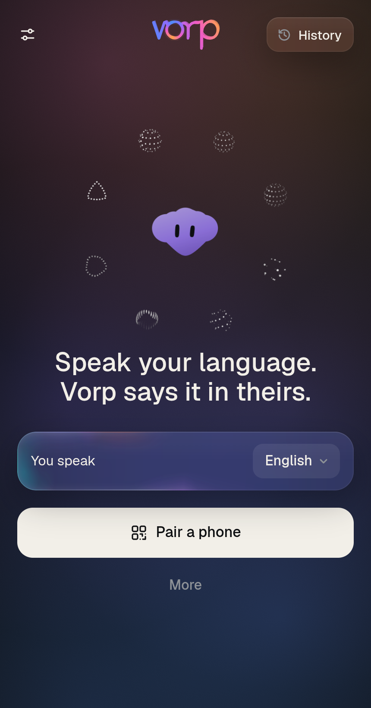
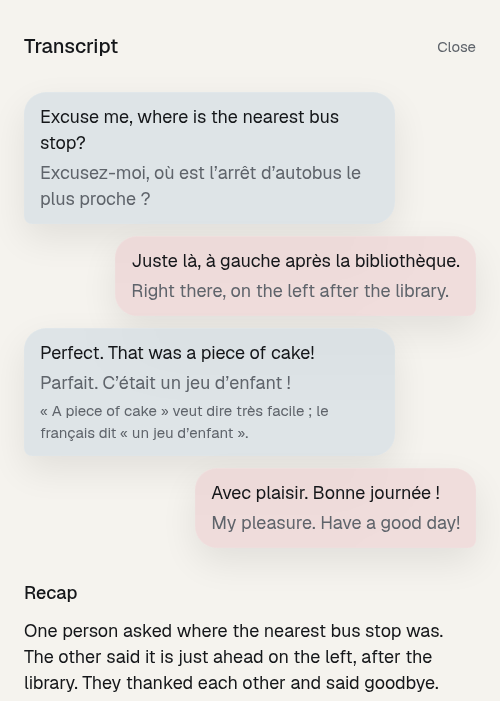
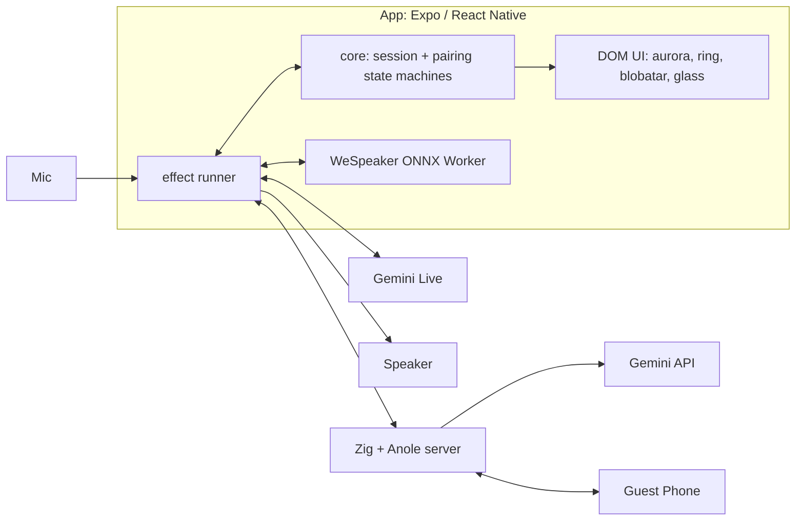

<p align="center">
  
</p>

<h3 align="center">Speak your language. Vorp says it in theirs.</h3>

<p align="center">
  A live voice interpreter for two people. Built for the GDG Sudbury hackathon, 2026.
</p>

<p align="center">
  
  &nbsp;
  
  &nbsp;
  
</p>

## What it does

- **One phone, or two.** Share one device, or tap **Pair a phone** to link a second phone by QR — no app or account needed.
- **Hands-free in 99 languages.** Auto-detects their language and ends turns automatically, with **Hold to talk** for noisy rooms.
- **Listens while it speaks.** On-device voiceprints tell you apart and filter out Vorp's own voice without muting the mic.
- **Meaning, not just words.** Keeps tone and register across, adds caption-only cultural notes for idioms, and writes a bilingual recap at the end.
- **Private and demo-ready.** History and voiceprints stay on-device; audio is never stored. Open **History → Watch the demo** to try it offline.

## How Gemini is used

- **`gemini-3.8-live`** — single streaming session for audio in, translated speech out, transcripts, and VAD (`NO_INTERRUPTION`).
- **Function calling** — `report_language` routes the speaker; `add_note` attaches cultural notes.
- **Ephemeral tokens** — the server mints single-use tokens (`POST /token`) so the API key never reaches the browser.
- **`gemini-3.8-flash`** — writes the bilingual recap on the server (`POST /recap`).
- **`gemini-3.8-flash-tts`** — recorded the offline demo voices.

## Run it

Needs [Bun](https://bun.sh), [Zig 0.17](https://ziglang.org), and a Gemini API key.

```bash
bun install
cp .env.example .env          # add GEMINI_API_KEY

bun run token-server          # terminal 1 (:8787)
EXPO_PUBLIC_TOKEN_URL=http://localhost:8787/token bun run web -- --port 8081   # terminal 2
```

Production (single origin):

```bash
bun run export:web
WEB_DIR=dist bun run token-server     # http://localhost:8787
```

Checks: `bun run lint`, `bun run typecheck`, `bun test`, `bun run test:server`, `bun run e2e:live`, `bun run e2e:pair`.

## How it is built



- **Pure state machines** (`src/core/`) drive both solo sessions and QR-paired rooms; effects are plain data run by one runner.
- **Zig + Anole server** (`server/`) handles ephemeral tokens, recaps, static hosting, and in-memory WebSocket pairing rooms.
- **On-device voiceprint** runs WeSpeaker ResNet34-LM in a Web Worker (same-origin, skipped on guest phones).
- **Interfaces & data tables** (`src/services/`, `src/config/`) keep audio, AI, demo scripts, languages, and behaviours swappable.

See [`AGENTS.md`](AGENTS.md), [`TODO.md`](TODO.md), [`docs/pairing-protocol.md`](docs/pairing-protocol.md), and [`landing/index.html`](landing/index.html).

## Status & licence

Web is the demo target (Chrome, solo and paired). Android and iOS build from the same codebase; native audio services are pending.

Apache-2.0. Uses [Libraries.dev](https://github.com/Jakubantalik/Libraries.dev) (MIT), [blobatar](https://github.com/Alain00/blobatar) (MIT), [uqr](https://github.com/unjs/uqr) (MIT), and [WeSpeaker ResNet34-LM](https://huggingface.co/onnx-community/wespeaker-voxceleb-resnet34-LM) weights (CC-BY-4.0); see [`THIRD_PARTY_NOTICES.md`](THIRD_PARTY_NOTICES.md).
