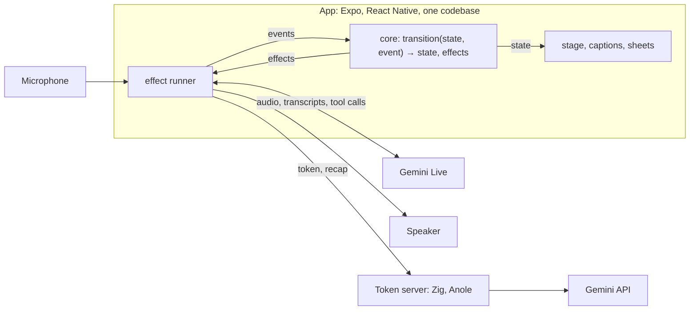

A live voice interpreter. Two or three people speak normally, each in their own language. When
someone stops, Vorp says it in the other language, and it keeps listening while it talks.

Built for the GDG Sudbury hackathon, 2026 (theme: language and culture).

 

## What it does

- **Hands-free.** No buttons: the end of an utterance is detected, and the language that was
  spoken names the speaker and the direction. A hold-to-talk button per person stays for noisy
  rooms.
- **Listens while it speaks.** New speech is captured during a translation and spoken next, in
  order.
- **An interpreter, not a chatbot.** It carries meaning, tone and register across, and never
  answers on its own behalf.
- **Cultural notes.** An idiom gets a short written note under the caption. It is never spoken.
- **Recap.** When a conversation ends, a summary in every language.
- **Every language the model supports**, a choice of voice, tone (neutral, casual, formal), and
  a transcript and history kept on the device only. Audio is never stored.
- **A demo** that needs no microphone, network or key: press Demo.

## How Gemini is used

- **Gemini Live API** (`gemini-3.8-live`) is the whole speech pipeline: one streaming session
  takes microphone audio in and gives translated speech out, with transcripts of both for the
  captions. Its voice activity detection ends the turns.
- **Function calling** inside that session: the model reports the language it heard
  (`report_language`), which is how Vorp knows who spoke, and attaches cultural notes
  (`add_note`).
- **Ephemeral tokens.** The browser never sees the API key. A small server trades it for a
  single-use Live token.
- **`gemini-3.8-flash`** writes the recap, on the server.
- **`gemini-3.8-flash-tts`** spoke the demo's recorded lines.

## Run it

Needs [Bun](https://bun.sh), [Zig 0.17](https://ziglang.org) and a Gemini API key.

```bash
bun install
cp .env.example .env          # then put your key in GEMINI_API_KEY

bun run token-server          # terminal 1: tokens and recaps on :8787
EXPO_PUBLIC_TOKEN_URL=http://localhost:8787/token bunx expo start --web --port 8081   # terminal 2
```

Open `http://localhost:8081`. Press **Demo** to watch a recorded conversation, or **Start** and
talk.

To serve everything from one origin, as in production:

```bash
bun run export:web
WEB_DIR=dist bun run token-server     # the app is at http://localhost:8787
```

Checks: `bun run lint`, `bun run typecheck`, `bun test`, `bun run test:server`.
`bun run e2e:live` speaks recorded sentences through the web build against the real API.

## How it is built



- **One state machine.** An utterance moves through
  `capturing → translating → queued → speaking → done | failed`. The whole conversation is one
  value and one pure function; effects are data run by a single runner. Listening while speaking
  is not a special mode, it is just two utterances at different stages.
- **Services behind interfaces.** Microphone, speaker, translator, recap and storage each have
  one interface. The demo is the same app on scripted implementations of them.
- **Swappable visuals.** The ring, avatar, thinking orb, caption glow and caption wave are slots
  with typed contracts and a registry; Settings swaps them at runtime.
- **Tables, not branches.** Languages, voices, tones, behaviours and policies are data.

`AGENTS.md` records the design decisions; `TODO.md` is the roadmap and says what has not been
checked on real devices yet.

## Status

Web is the target and works in Chrome. Android and iOS build from the same code, but the native
audio services are not written yet.

## Credits and licence

Apache-2.0. The visual effects are from [Libraries.dev](https://github.com/Jakubantalik/Libraries.dev)
by Jakub Antalik (MIT); see `THIRD_PARTY_NOTICES.md`.
