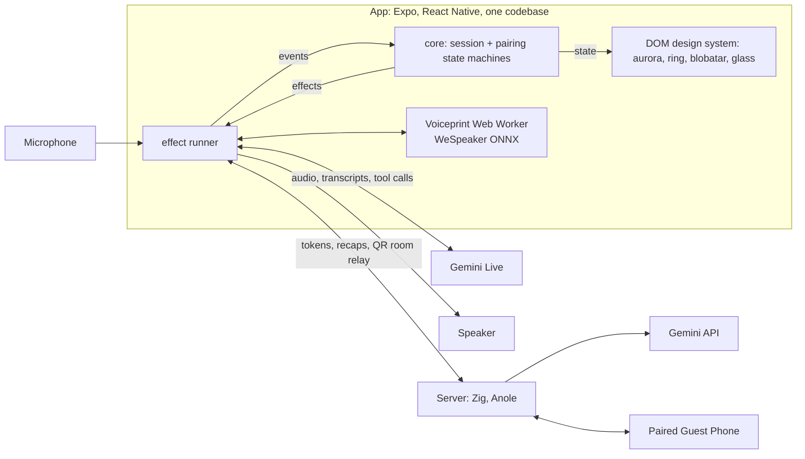

<p align="center">
  
</p>

<h3 align="center">Speak your language. Vorp says it in theirs.</h3>

<p align="center">
  A live voice interpreter for two people. Speak naturally in your own language — when you pause,<br>
  Vorp speaks it in theirs, and keeps listening while it talks.
</p>

<p align="center">
  Built for the GDG Sudbury hackathon, 2026 (theme: language and culture).
</p>

<p align="center">
  
  &nbsp;&nbsp;
  
  &nbsp;&nbsp;
  
</p>

## What it does

- **One phone, or two phones with one scan.** Place one device between you, or tap **Pair a phone**
  to show a QR code. The other person scans it with their camera and joins in their browser — no
  app to install, no account, and a lightweight guest page localised in 12 languages.
- **Hands-free across 99 languages.** Voice activity detection ends each turn automatically.
  **Detect their language** (on by default) switches to whatever language the other person speaks,
  and resets when the conversation ends. A **Hold to talk** button stays ready for noisy rooms.
- **Knows your voice, filters its own.** A three-sentence voice setup runs entirely on your device
  (WeSpeaker ResNet34-LM in a Web Worker) so Vorp recognises when it is you speaking. It also learns
  its own interpreter voice to filter out speaker echo alongside platform AEC and a transcript
  guard — so the mic stays open and new speech queues in order while Vorp talks.
- **An interpreter, never a chatbot.** Conveys meaning, tone, and register (neutral, casual,
  formal) without answering on its own behalf. When an idiom does not carry over literally, Vorp
  adds a short written cultural note in the listener's language under the caption — never spoken.
- **Transcript and bilingual recap.** Conversations are saved as tinted glass chat bubbles
  positioned by speaker, followed by a summary in both languages. History and voiceprint embeddings
  stay on your device only; audio is never stored.
- **Instant offline demo.** Open **History → Watch the demo** to experience a full recorded
  conversation — aurora, voice ring, avatar, distortion wave, cultural note, and recap — with no
  microphone, network, or API key.

## How Gemini is used

| Capability | Model / API | Role in Vorp |
| --- | --- | --- |
| Live speech pipeline | `gemini-3.8-live` (Live API) | Streaming session for 16 kHz mic audio in, 24 kHz translated speech out, live transcripts, and server-side VAD (`NO_INTERRUPTION`) |
| In-session tools | Function calling | `report_language` identifies the spoken language for routing; `add_note` attaches caption-only cultural notes in the listener's language |
| Ephemeral tokens | `/v1beta/auth_tokens` | The Anole server mints single-use Live tokens (`POST /token`) so the API key never reaches the browser |
| Bilingual recap | `gemini-3.8-flash` | Server-side summary in both languages when a conversation ends (`POST /recap`) |
| Demo voices | `gemini-3.8-flash-tts` | Generated the recorded speech bundled for the offline demo |

## Run it

Needs [Bun](https://bun.sh), [Zig 0.17](https://ziglang.org), and a Gemini API key.

```bash
bun install
cp .env.example .env          # put your key in GEMINI_API_KEY

bun run token-server          # terminal 1: tokens, recaps, and pairing rooms on :8787
EXPO_PUBLIC_TOKEN_URL=http://localhost:8787/token bun run web -- --port 8081   # terminal 2
```

Open `http://localhost:8081`. Press **Start** to talk, **Pair a phone** to link a second phone by
QR, or **History → Watch the demo** to try it offline.

To serve everything from one origin, as in production:

```bash
bun run export:web
WEB_DIR=dist bun run token-server     # the app is at http://localhost:8787
```

`/token` and `/recap` share a per-client rate limit (`TOKEN_RATE_LIMIT`, default 20/min), and
pairing rooms are bounded by `ROOM_RATE_LIMIT`, `ROOMS_PER_CLIENT`, and `MAX_ROOMS`. Behind a TLS
proxy or load balancer, set `ANOLE_PROXY_TRUSTED` so limits key on each visitor's address (see
`.env.example`). A standalone post-session landing page lives in [`landing/index.html`](landing/index.html).

Checks:

```bash
bun run lint                  # ESLint
bun run typecheck             # tsc --noEmit
bun test                      # unit tests (session, pairing, voiceprint, view models)
bun run test:server           # Anole token, recap, and pairing room tests
bun run e2e:live              # by hand: recorded speech through the web build against real Gemini
bun run e2e:pair              # by hand: two headless phones paired by QR against real Gemini
bun run smoke:voiceprint      # by hand: WeSpeaker cosine similarity check on recorded voices
```

## How it is built



- **Pure state machines.** An utterance moves through
  `capturing → translating → queued → speaking → done | failed` (`src/core/session.ts`). Two-phone
  rooms wrap that session in one pairing state machine (`src/core/pairing.ts`) with 60-second
  rejoin on socket drops and turn-taking between mic and speaker. Effects are plain data run by a
  single runner; listening while speaking is just multiple utterances in flight.
- **Zig + Anole backend (`server/`).** One small server issues single-use Gemini Live tokens
  (`POST /token`), runs server-side recaps (`POST /recap`), serves the static web export
  (`WEB_DIR`), and relays paired two-phone rooms over in-memory WebSocket rooms
  (`server/src/rooms.zig`, `server/src/pairing.zig`) with per-client rate limits and trusted-proxy
  support.
- **On-device voiceprint.** WeSpeaker ResNet34-LM (`onnx-community/wespeaker-voxceleb-resnet34-LM`,
  quantised 6.7 MB) ships same-origin under `public/models/` and runs in a Web Worker via
  `transformers.js` + ONNX Runtime Web — nothing is fetched from a CDN, and guest phones skip
  downloading it entirely.
- **Services behind interfaces.** `AudioInput`, `AudioOutput`, `Translator`, `VoiceEmbedder`,
  `PairingLink`, `WakeLock`, `Cues`, recap, and storage each sit behind one interface. The offline
  demo runs the real stage on scripted implementations.
- **Ported DOM design system.** `src/ui/dom`, `src/features/app/dom`, and `src/features/pair/dom`
  render the WebGL dithered aurora, trace logo, voice ring, blobatar, distortion wave, rainbow
  border beam, QR code, and frosted tinted glass (`Glass`) inside an Expo DOM boundary
  (`'use dom'`), keeping the guest route `/join/[code]` in a small async chunk.
- **Tables, not branches.** Languages, voices, tones, behaviours, enrolment sentences, guest copy,
  and overlap policies are declarative data tables in `src/config`.

| Path | Role |
| --- | --- |
| `src/app/` | Expo Router routes (`index`, `join/[code]`, dev `gallery`) |
| `src/core/` | Pure domain state machines (`session`, `pairing`, `voiceprint`) — no React, no I/O |
| `src/services/` | Platform & provider I/O behind interfaces (Gemini Live, audio, worker, pairing, storage) |
| `src/features/` | View models, effect runners, and screens (`app`, `conversation`, `enrolment`, `pair`, `history`, `settings`) |
| `src/ui/` | Design tokens, frosted glass, slot contracts, DOM design system, and vendored effect engines |
| `src/config/` | Data tables: 99 languages, voices, prompts, tones, behaviours, pairing copy, voiceprint config |
| `server/` | Zig 0.17 + Anole server: `/token`, `/recap`, WebSocket pairing rooms, static web hosting |
| `landing/` | Standalone post-session landing page (`landing/index.html`) |

See [`AGENTS.md`](AGENTS.md) for design decisions, [`TODO.md`](TODO.md) for the roadmap,
[`docs/pairing-protocol.md`](docs/pairing-protocol.md) for the QR room protocol, and
[`assets/brand/README.md`](assets/brand/README.md) for brand assets.

## Status

Web is the demo target and works in Chrome (solo and paired two-phone rooms). Android and iOS build
from the same codebase, with native audio services still to be written.

## Credits and licence

Apache-2.0. Visual effect engines from [Libraries.dev](https://github.com/Jakubantalik/Libraries.dev)
by Jakub Antalik (MIT), [blobatar](https://github.com/Alain00/blobatar) by Alain (MIT), QR encoding
by [uqr](https://github.com/unjs/uqr) (MIT), and speaker embedding weights from
[WeSpeaker ResNet34-LM](https://huggingface.co/onnx-community/wespeaker-voxceleb-resnet34-LM)
(CC-BY-4.0); see [`THIRD_PARTY_NOTICES.md`](THIRD_PARTY_NOTICES.md) for full notices.
