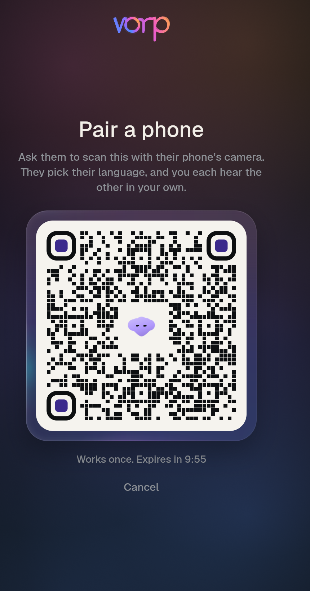
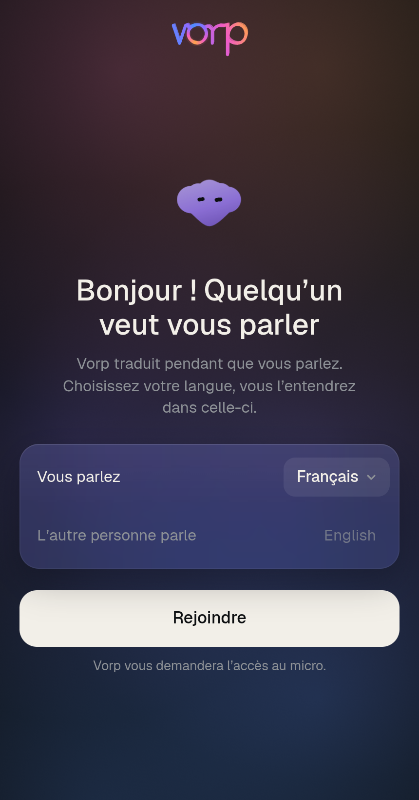
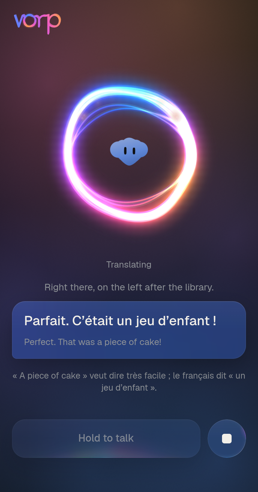
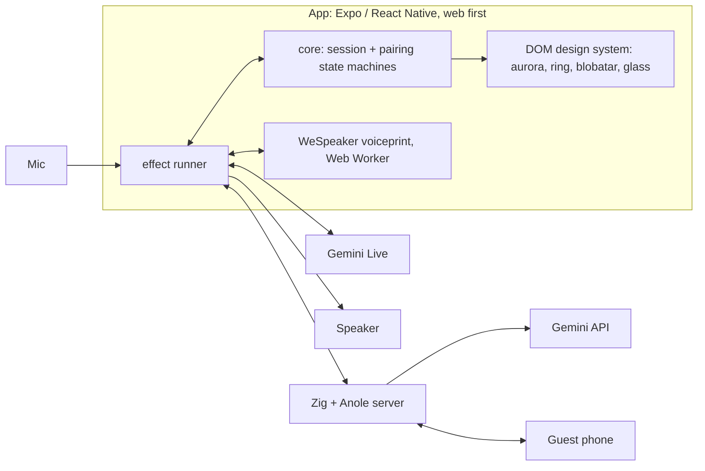

<p align="center">
  
</p>

<h3 align="center">Speak your language. Vorp says it in theirs.</h3>

<p align="center">
  A live voice interpreter for two people who don't share a language.<br>
  You speak normally; when you stop, the other person hears you in their language, on their own phone.
</p>

<p align="center">
  <a href="https://xuckless.github.io/vorp/">Product page</a> ·
  <a href="https://vorp.alidirect.dev">Live demo (booth mode)</a> ·
  Built for the GDG Sudbury hackathon, November 2026
</p>

<p align="center">
  
  &nbsp;
  
  &nbsp;
  
</p>

## Who it is for

Two people in the same room who need to talk and can't: a newcomer at a front desk, a parent at a
school meeting, a customer and a shop owner, a visitor and a host. Vorp is for the everyday
conversation where you would otherwise point at a phone screen, type, and hand it back.

It is not for high-stakes interpreting such as medical consent or legal proceedings. Those need a
certified human interpreter (see [How it compares](#how-it-compares)).

## What happens in a conversation

1. **You tap Pair a phone.** Vorp shows a QR code.
2. **They scan it with their phone's camera.** A page opens in their browser, already in their
   language. They confirm the language they speak and tap Join. There's nothing to install and no
   account.
3. **You both just talk.** When one of you stops speaking, the other hears the translation from
   their own phone, with captions of both sides on both screens. Nobody presses a button per turn.
4. **Either of you taps Stop.** It ends for both. You keep the transcript, and a two-language recap
   if you want one. Their phone keeps nothing.

Vorp also works on **one phone** placed between two people (Start on this phone, under More). It
then tells who is speaking by language, or by your voice once it has learned it.

## Questions people ask before trusting it

**Does the other person need the app?**
No. They need a phone with a camera and a browser. The page they open is light (nothing heavy
downloads to a stranger's phone) and asks one question: what language they speak.

**Which languages?**
The 99 languages Gemini Live supports, with English and French first. You never pick a direction:
each phone translates its owner's speech into the other person's language.

**Does it wait for me to finish, or cut me off?**
It waits. Turns end after about 0.7 s of silence, detected by Gemini Live itself. In a noisy room,
**Hold to talk** makes the end of your turn explicit.

**Can I keep talking while it's speaking?**
Yes. Vorp keeps listening while a translation plays and queues the next one, so the conversation
never stalls behind the interpreter. On two phones, the microphone and speaker take turns so a
phone never translates its own loudspeaker.

**Will it answer for me, or change what I said?**
It is told to interpret, never to reply: it conveys meaning, tone and register, and adds or drops
nothing. A question gets translated, not answered. When an idiom doesn't carry over, it adds a
short written note under the caption instead of changing your words.

**What happens to what we say?**
Audio is never stored. Transcripts, history and your voiceprint stay on your device; there are no
accounts and no cloud storage. The paired relay server only passes the translated audio and
captions between the two phones; it never sees microphone audio and keeps nothing that was said. The Gemini API key stays on the
server and phones get single-use tokens.

**What does it need to work?**
A network connection and a modern browser. Chrome is the tested path so far.
Translation runs on Gemini, so Vorp does not work offline.

## Why Vorp

What we can back up, and how we checked it:

- **The other person joins with only their camera.** One QR scan, one tap, in
  their own language from the first screen. Checked end to end with two headless phones against
  real Gemini (`bun run e2e:pair`) and on the deployed site.
- **Hands-free, both ways, at once.** One Gemini Live session per phone carries speech in and
  translated speech out. Speech that arrives while the model is replying is held and sent when the
  reply ends, so nothing is lost. Checked against real sessions with recorded English and French
  speech (`bun run e2e:live`).
- **It interprets, it doesn't chat.** The interpreter prompt held in live sessions: questions came
  back translated, not answered.
- **It knows who spoke.** The model reports the language of each utterance through a function
  call, which picks the speaker and the direction. On one phone, an on-device voiceprint
  (WeSpeaker, in a Web Worker) recognises the owner and filters out Vorp's own voice without
  muting the microphone.
- **Private by construction.** No accounts, no stored audio, the key never in the browser. These
  follow from the architecture below, not from a policy.

## How it compares

| If you use… | It's good at… | Where Vorp is different |
| --- | --- | --- |
| A phrase translator app with a talk button | Quick phrases; some work offline | Vorp ends turns by itself and each person stays on their own phone, so nobody passes a device back and forth |
| A shared-screen conversation mode | One device, two languages on one screen | Vorp puts each person on their own phone and speaker; on one phone it also tells speakers apart by voice |
| Live translation built into a phone or earbuds | Polished on supported hardware | Vorp runs in any modern browser; the other person needs no particular device or app |
| A human interpreter | Accuracy, accountability, sensitive settings | Vorp is instant and free to start, but it is not a substitute where errors have consequences |

The trade-offs are real: Vorp needs a network, depends on Gemini's quality for each language, and
has been tested most on Chrome. iPhone Safari and noisy rooms are next on the test list.

## Try it, and tell us

- **Product page and vote:** [xuckless.github.io/vorp](https://xuckless.github.io/vorp/)
- **See it live:** the Vorp booth at Collège Boréal, Saturday 28 November 2026. The public site runs
  in booth mode: a conversation starts from a host's QR code.
- **Run it yourself:** see [Run it](#run-it). On a local build, History › Watch the demo plays a
  scripted conversation without a microphone or a key.
- **Tell us where it broke:** [open an issue](https://github.com/xuckless/vorp/issues) with the two
  languages and what was said. Missed translations are the most useful reports we can get.

Vorp is days old and has no reviews yet. If you used it, a mention or an issue helps more than a
star.

## How Gemini is used

- **`gemini-3.8-live`**: one streaming session per phone for speech in, translated speech out,
  both transcripts and turn detection (`NO_INTERRUPTION`, so a reply is never cut off).
- **Function calling**: `report_language` names the language of each utterance and routes it;
  `add_note` attaches a caption-only cultural note.
- **Ephemeral tokens**: the server mints single-use Live tokens, so the API key never reaches a
  browser.
- **`gemini-3.8-flash`**: writes the two-language recap on the server.
- **`gemini-3.8-flash-tts`**: voiced the scripted demo and the test recordings.

## Run it

Needs [Bun](https://bun.sh), [Zig 0.17](https://ziglang.org) and a Gemini API key.

```bash
bun install
cp .env.example .env          # add GEMINI_API_KEY

bun run token-server          # terminal 1, :8787
bun run web                   # terminal 2, with EXPO_PUBLIC_TOKEN_URL=http://localhost:8787/token in .env
```

One origin, as deployed: `bun run export:web`, then `WEB_DIR=dist bun run token-server`.
`bun run deploy` builds the booth version (host passes on, see `.env.example`) and installs it on
the Compute Engine VM.

Checks: `bun run lint`, `bun run typecheck`, `bun test`, `bun run test:server`; against real
Gemini, by hand: `bun run e2e:live`, `bun run e2e:pair`.

## Architecture



- **One state machine per concern** (`src/core/`): a conversation is one value and one pure
  `transition(state, event) -> [state, effects]`; a paired phone wraps its own conversation in a
  second machine for the room. Effects are plain data, run by one effect runner. Behaviour is
  tested with event sequences, no mocks of audio or network.
- **Services behind interfaces** (`src/services/`): audio in and out, the Gemini translator, the
  voiceprint, storage and the pairing link each have one interface, with web and native
  implementations chosen by file suffix.
- **Data, not branches** (`src/config/`): languages, voices, models, prompts, interpreter
  behaviours and the demo script are tables.
- **Zig server on Anole** (`server/`): ephemeral tokens, recaps, the static web app and the
  in-memory WebSocket rooms that pair two phones. Costly routes take a per-host pass (`X-API-Key`);
  a guest gets tokens with its room key while paired. Deployed on Compute Engine behind Caddy
  (`scripts/deploy/`).
- **Design** (`src/ui/dom`, `src/features/*/dom`): the signed-off design as DOM components, inline
  on web and in a web view on native.

```
src/app/        routes only
src/core/       pure domain: types, state machines, effects as data
src/services/   I/O behind interfaces
src/features/   screens and their view models
src/ui/         design system and imported effects
src/config/     data tables
server/         token, recap and pairing server (Zig, Anole)
landing/        the product page (GitHub Pages)
```

Decisions and their reasons are in [`AGENTS.md`](AGENTS.md); the pairing wire contract is
[`docs/pairing-protocol.md`](docs/pairing-protocol.md); the roadmap is [`TODO.md`](TODO.md).

## Licence

Apache-2.0. Uses [Libraries.dev](https://github.com/Jakubantalik/Libraries.dev) (MIT),
[blobatar](https://github.com/Alain00/blobatar) (MIT), [uqr](https://github.com/unjs/uqr) (MIT) and
the [WeSpeaker ResNet34-LM](https://huggingface.co/onnx-community/wespeaker-voxceleb-resnet34-LM)
weights (CC-BY-4.0). See [`THIRD_PARTY_NOTICES.md`](THIRD_PARTY_NOTICES.md).
